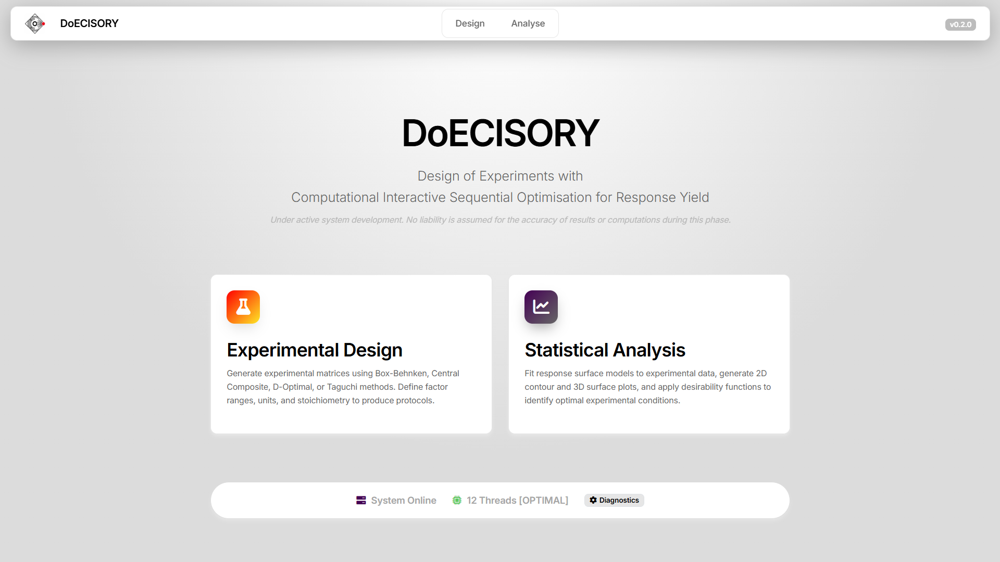
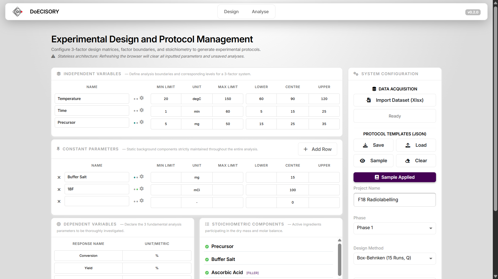
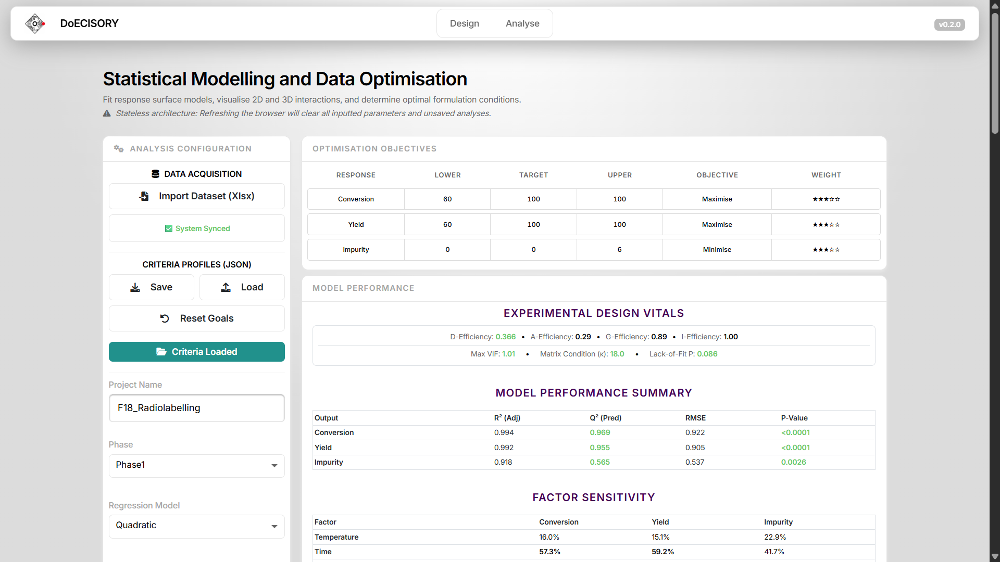
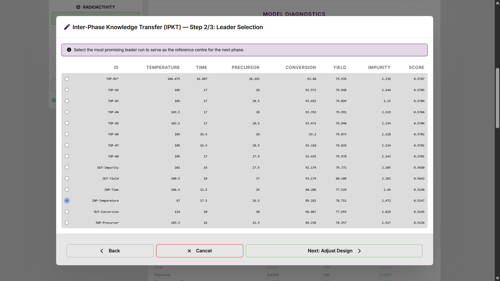
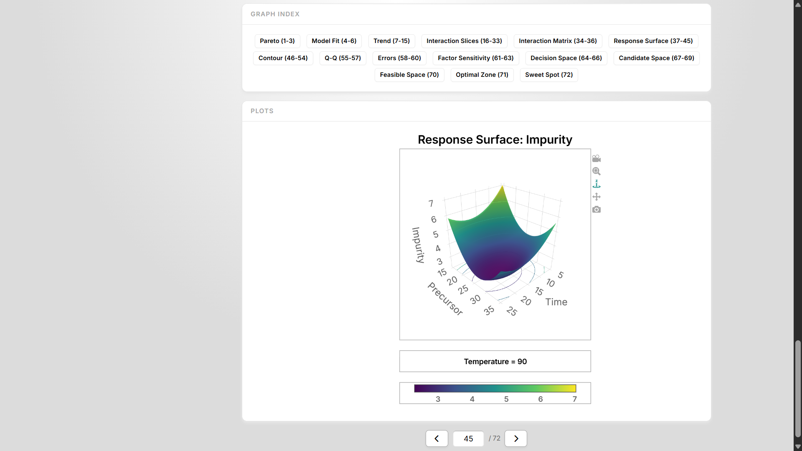
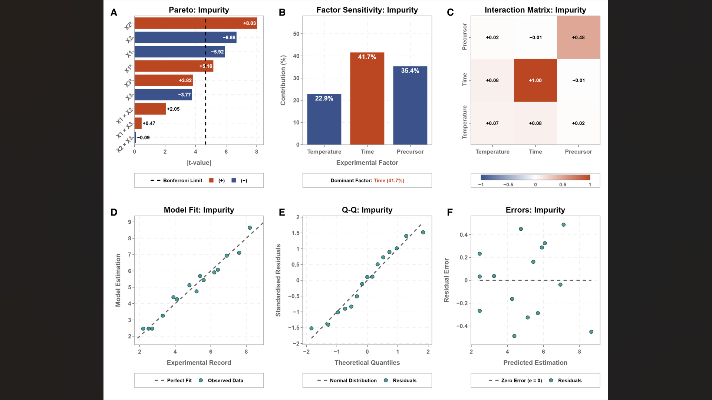

# DoECISORY.jl

**Design of Experiments with Computational Interactive Sequential Optimisation for Response Yield**

[]()
[](https://doi.org/10.5281/zenodo.23276841)
[](https://orcid.org/0009-0000-4491-7759)

[](https://julialang.org)
[](LICENSE)
[](https://codecov.io/gh/erensgol/DoECISORY.jl)
[](https://github.com/erensgol/DoECISORY.jl/actions/workflows/CI.yml)
[](https://erensgol.github.io/DoECISORY.jl/dev/)
[](https://erensgol-doecisory.hf.space)

**DoECISORY.jl** is an open-source, registered Julia package and stateless Dash web application developed for Design of Experiments (DoE), Response Surface Methodology (RSM), stoichiometric verification, and multi-objective optimisation. Executable across local workstations, cloud environments, the native Julia REPL, and reactive Pluto.jl notebooks, it integrates multi-response statistical modelling and interactive visual analytics within adaptive sequential workflows that contract and translate search spaces from screening to fine-tuning. Integrated first-order kinetic compensations correct for time-dependent reagent degradation: normalising pre-reaction preparation intervals, restoring end-of-synthesis (EOS) yields, and arbitrating reaction trade-offs via kinetic penalty profiling.

> *If you use DoECISORY.jl in your research or publications, please cite the software using the [metadata below](#citation).*

---

## Core Capabilities

* **3-Factor Experimental Designs**: Matrices for 3-factor formulation spaces, including Box-Behnken (BB15), Central Composite (CD17), Taguchi (TL09), and Fractional D-Optimal (DF14).
* **Information Optimality Metrics**: Evaluation of D-, A-, G-, and I-efficiencies and design matrix condition numbers.
* **Stoichiometry and Mass Balance**: Automated mass balance audits, excipient balancing, molar ratios, and concentration consistency checks.
* **Decay Adjustments**: Pre-reaction preparation decay normalisation and post-reaction measurement restoration back to End of Synthesis (EOS).
* **Multi-Objective Optimisation and DCYP**: Derringer-Suich desirability profiling with continuous and categorical criteria:
  - **Decay-Coupled Yield Penalty (DCYP)**: In-reaction kinetic trade-off arbitration penalising prolonged duration against exponential isotope decay.
  - **Gaussian Neighbour-Weighting Regularisation**: Smoothens multi-objective landscape ridges for stable metaheuristic and grid convergence.
* **Candidate Pool Formulation**: Generates a tiered portfolio of viable formulations rather than a single point:
  - *Absolute Leaders (`TOP-XX`)*: Highest unconstrained composite desirability.
  - *Input Minimisation (`INP-<Factor>`)*: Cost-saving formulations achieving $\ge 90\%$ desirability with minimal reagent consumption or thermal stress.
  - *Output Specialisation (`OUT-<Response>`)*: Solutions prioritising critical quality attributes like minimal impurity or specific activity.
* **Sequential Interphase Transfer (ACTA and ASTM)**: Bridges successive experimental phases through:
  - *ACTA (Adaptive Contraction & Translation Algorithm)*: Evaluates relative position ($p_i$) to contract search boundaries ($c$) around the leader or translate them ($\delta$) upon boundary contact.
  - *ASTM (Affine Space Transformation Model)*: Applies affine scaling ($x_{\text{new}} = \alpha \cdot x_{\text{old}} + \beta$) and absolute physical clamping.
* **Statistical Diagnostics**: Seven-stage scientific analysis report featuring OLS linear and quadratic regression, ANOVA, Lack-of-Fit tests, cross-validated $Q^2$ (overfitting protection), and VIF multicollinearity screening.
* **Visualisation and Publication Plates**: PlotlyJS 3D response surfaces, equipotential 2D contour maps with fixed-factor slicing, IPKT interval shift charts, and 3-tier concentric decision space exploration.
  - **145 mm Composite Vector Plates**: Automated assembly of composite SVG plates for double-column journal formats with standardized 8 pt Helvetica Bold labels.
  - **Single-Click Portfolio Export**: Direct ZIP export placing the composite SVG plates, `ANALYTICS.xlsx`, and `REPORT.txt` in the root, with individual high-resolution PNG plots in `PNGPLOTS/`.
* **Spreadsheet Data Exchange (Excel)**: Multi-sheet protocol workbooks (`.xlsx`) with formatting standards, formula preservation, and zero data loss.

---

## System Workspaces and Sequential Workflow

DoECISORY.jl separates functional interfaces from sequential experimental phases:

### User Workspaces
* **`Gui_Deck` (Design & Formulation Workspace)**: Stoichiometric mass balance checks (`Lib_Mole`), factor definitions, 3-factor matrix generation (`BB15`, `CD17`, `TL09`, `DF14`), and protocol workbook export (`Sys_Fast`).
* **`Gui_Lens` (Analytics & Decision Workspace)**: Ingestion of completed experimental datasets, automatic decay corrections (precursor forward decay and EOS reverse decay via `VISE_ApplyFRDecay_DDEF`), OLS quadratic regression, ANOVA, cross-validated $Q^2$, Lack-of-Fit, DCYP multi-objective optimisation, Candidate Pool inspection, and 7-stage reporting (`Lib_Vise`, `Lib_Arts`).
* **`Sys_Flow` (Interphase Transition Engine)**: Executes IPKT (ACTA boundary contraction/translation + ASTM affine space projection and clamping) to transition between sequential experimental phases.

### Sequential Experimental Workflow
1. **Phase 1 (Screening)**: Formulate in `Gui_Deck` $\rightarrow$ execute laboratory runs $\rightarrow$ analyse and generate candidate pool in `Gui_Lens`.
2. **Interphase Knowledge Transfer (IPKT = ACTA + ASTM)**: Select a candidate leader from the pool in `Gui_Lens` $\rightarrow$ apply ACTA contraction/translation ($c$, $\delta$) $\rightarrow$ apply ASTM affine scaling/regeneration ($\alpha \cdot x + \beta$) and clamping via `Sys_Flow`.
3. **Phase 2 (Refinement)**: Automatically load adapted boundaries into `Gui_Deck` $\rightarrow$ generate Phase 2 protocol matrix with prior variance preserved $\rightarrow$ execute and verify in `Gui_Lens`.

### Visual Interface Walkthrough

| **Application Landing & Workspace Gateway** | **Gui_Deck: Formulation & Experimental Design** |
| :---: | :---: |
| [](docs/src/assets/ui_landing_overview.png) | [](docs/src/assets/ui_deck_formulation.png) |
| *Central workspace launch portal and live hardware diagnostics.* | *Factor space setup, stoichiometry, and protocol configuration.* |
| **Gui_Lens: Multi-Objective Statistical Analytics** | **Sys_Flow: Inter-Phase Knowledge Transfer (IPKT)** |
| [](docs/src/assets/ui_lens_analytics_page.png) | [](docs/src/assets/ui_candidate_pool.png) |
| *Model diagnostics, design vitals, and multi-objective targets.* | *Sequential phase transition and candidate leader selection.* |
| **Lib_Arts: Interactive Response Surfaces & Slicing** | **Sys_Fast: 145 mm Publication Composite Plate** |
| [](docs/src/assets/ui_response_surfaces.png) | [](docs/src/assets/ui_composite_plates.png) |
| *Interactive 3D response surface with categorical navigation.* | *Standardised 145 mm composite plate for journal publication.* |

---

## Usage Pathways

DoECISORY.jl supports three distinct execution pathways depending on operational and research requirements:

---

### Pathway 1: Cloud Deployment (Hugging Face Spaces)

DoECISORY.jl is deployed as a containerised service on Hugging Face Spaces, providing access to the complete computational platform and graphical interface without requiring local Julia installation, dependency resolution, or local storage.

Select the access point according to your operational goal:

* **[Launch Web Application](https://erensgol-doecisory.hf.space)** *(Primary Workspace)*  
  Opens the DoECISORY.jl interface directly in your browser without external platform headers.

* **[Hugging Face Space Portal](https://huggingface.co/spaces/erensgol/DoECISORY)** *(Container Management & Wake-up)*  
  Use if the cloud container has entered sleep mode to trigger a wake-up restart.

---

### Pathway 2: Julia Package Ecosystem (`Pkg`)

For integration into existing Julia workflows, computational pipelines, or standard interactive use:

```julia
using Pkg
# Install officially from the Julia General Registry:
Pkg.add("DoECISORY")

# Or install the latest development branch directly from GitHub:
Pkg.add(url="https://github.com/erensgol/DoECISORY.jl")

using DoECISORY
```

#### Option 2A: Launching the Web Interface

Launch the graphical user interface locally either from within an interactive Julia session or directly from the system shell:

* **Standard Server Mode (Live Terminal Logs)**  
  Launches the web server, opens your browser, and streams live operational logs to the console:
  - From Julia REPL:
    ```julia
    using DoECISORY
    launch(; wait=true)
    ```
    *(Press `Ctrl + C` in the console to terminate the server).*
  - Direct from system shell (CLI one-liner):
    ```bash
    julia --threads=auto -e "using DoECISORY; launch(; wait=true)"
    ```

* **Asynchronous REPL Mode (Background Task)**  
  Spawns the in-process server as an asynchronous background task, keeping the active REPL prompt accessible for simultaneous scripting:
  ```julia
  using DoECISORY
  launch() # non-blocking (wait=false)
  ```

#### Option 2B: Headless Algorithmic Execution (Julia REPL, Scripts & Pluto.jl)

Mathematical, stoichiometric, and statistical routines in DoECISORY.jl can be executed directly without launching the graphical user interface. This enables interactive computational workflows within the **Julia REPL**, standalone `.jl` scripts, and reactive **Pluto.jl** notebooks:

> [!TIP]
> **Running within Pluto.jl:**  
> When executing within Pluto.jl, launching from an isolated shared environment (`julia --project=@pluto -e "using Pluto; Pluto.run()"`) is recommended to avoid global package compatibility constraints.

```julia
using DoECISORY

# 1. Synthesise experimental design matrix & inspect information optimality
begin
  plan = design(:bb15;
    factors = ["Temperature", "Time", "Precursor"],
    levels  = [(60.0, 90.0, 120.0), (5.0, 15.0, 25.0), (15.0, 25.0, 35.0)]
  )
  show(stdout, MIME("text/plain"), plan.dataframe; allrows=true)
  println()
  println("D-Efficiency                    : ", round(plan.metrics["D"] * 100.0, digits=2), "%")
  println("G-Efficiency                    : ", round(plan.metrics["G"] * 100.0, digits=2), "%")
  println("Condition No                    : ", round(plan.metrics["Condition"], digits=2))
end

# 2. Fit quadratic response surface models from laboratory observations
begin
  X = plan.matrix;
  Y_conv   = [87.4, 53.1, 73.6, 77.2, 94.5, 87.0, 65.3, 82.7, 75.5, 92.1, 87.7, 59.9, 80.4, 70.2, 90.6]
  Y_yield  = [77.6, 45.2, 66.1, 69.9, 72.4, 77.1, 57.4, 73.8, 67.5, 74.2, 77.9, 51.1, 70.3, 63.4, 73.8]
  Y_impur  = [2.5,  8.2,  4.8,  6.4,  5.2,  2.2,  6.9,  4.1,  5.6,  3.3,  2.7,  7.6,  5.4,  6.2,  3.9]
  models = [
    VISE_Regress_DDEF(X, Y_conv,  "quadratic"; InNames=plan.factors),
    VISE_Regress_DDEF(X, Y_yield, "quadratic"; InNames=plan.factors),
    VISE_Regress_DDEF(X, Y_impur, "quadratic"; InNames=plan.factors)
  ]
  println("Model R² (Conv, Yield, Impurity)  : ", [round(m["R2"]; digits=3) for m in models])
  println("Model RMSE (Conv, Yield, Impurity): ", [round(m["RMSE"]; digits=2) for m in models])
end

# 3. Multi-response desirability optimisation with 18F DCYP, sensitivity & ACTA
begin
  goals = [
    Dict("Type" => "Maximise", "Min" => 50.0, "Max" => 98.0, "Target" => 92.0, "Weight" => 1.0),
    Dict("Type" => "Maximise", "Min" => 40.0, "Max" => 85.0, "Target" => 80.0, "Weight" => 1.2),
    Dict("Type" => "Minimise", "Min" => 1.0,  "Max" => 10.0, "Target" => 2.0,  "Weight" => 1.5)
  ]
  dcyp = [CORE_ModifierDCYP_DDES(2, log(2.0) / 109.8, "18F")]
  box  = hcat(minimum(X; dims=1)', maximum(X; dims=1)')
  (opt_x, opt_score) = CORE_OptimiseDesirability_DDEF(models, goals, box; MaxTime=0.4, ModifiersDCYP=dcyp)
  opt_preds          = [round(VISE_Predict_DDEF(m, reshape(opt_x, 1, 3))[1]; digits=1) for m in models]
  sensitivities      = VISE_AnalyseSensitivity_DDEF(models[1], opt_x, X)
  acta_bounds        = FLOW_CalcACTA_DDEF(opt_x[1], [60.0, 90.0, 120.0], 0.5, 0.0, 0.0)
  phase2_levels      = [FLOW_ApplyASTM_DDEF(x, 0.9, 9.0) for x in acta_bounds]
  println("Multi-Desirability Score        : ", round(opt_score; digits=4))
  println("Optimum (Temp, Time, Precursor) : ", round.(opt_x; digits=2))
  println("Predicted Responses at Optimum  : ", opt_preds)
  println("Factor Sensitivities (%)        : ", round.(sensitivities .* 100.0; digits=1))
  println("ACTA Phase 2 Contraction (Temp) : ", round.(acta_bounds; digits=2))
  println("ASTM Phase 2 Scaling (Temp)     : ", round.(phase2_levels; digits=2))
end
```

Expected execution output:

```text
15×3 DataFrame
 Row │ Temperature  Time     Precursor
     │ Float64      Float64  Float64
─────┼─────────────────────────────────
   1 │        90.0     15.0       25.0
   2 │        60.0      5.0       25.0
   3 │       120.0      5.0       25.0
   4 │        60.0     25.0       25.0
   5 │       120.0     25.0       25.0
   6 │        90.0     15.0       25.0
   7 │        60.0     15.0       15.0
   8 │       120.0     15.0       15.0
   9 │        60.0     15.0       35.0
  10 │       120.0     15.0       35.0
  11 │        90.0     15.0       25.0
  12 │        90.0      5.0       15.0
  13 │        90.0     25.0       15.0
  14 │        90.0      5.0       35.0
  15 │        90.0     25.0       35.0

D-Efficiency                      : 36.64%
G-Efficiency                      : 88.89%
Condition No                      : 17.97
Model R² (Conv, Yield, Impurity)  : [0.998, 0.997, 0.971]
Model RMSE (Conv, Yield, Impurity): [0.92, 0.9, 0.54]
Multi-Desirability Score          : 0.897
Optimum (Temp, Time, Precursor)   : [103.18, 15.5, 27.8]
Predicted Responses at Optimum    : [92.0, 79.6, 2.1]
Factor Sensitivities (%)          : [11.6, 68.7, 19.7]
ACTA Phase 2 Contraction (Temp)   : [88.18, 103.18, 118.18]
ASTM Phase 2 Scaling (Temp)       : [88.36, 101.86, 115.36]
```

> **Design Space Scope:** DoECISORY.jl is designed for 3-factor experimental and formulation studies. Matrix generators (`BB15`, `CD17`, `TL09`, `DF14`), optimality calculations, and response surface models operate on 3 continuous factors.

#### Option 2C: Package Test Suite Verification

To verify package integrity and dependencies in an installed environment:

* **Interactive REPL Test Execution**  
  ```julia
  using Pkg
  Pkg.test("DoECISORY")
  ```

* **Standalone Command-Line Test One-Liner**  
  ```bash
  julia -e "using Pkg; Pkg.test(\"DoECISORY\")"
  ```

---

### Pathway 3: Source Repository Deployment (`git clone`)

For developers, power users, and researchers requiring complete operational control, live code watching, AOT sysimage compilation, or source modification:

```bash
git clone https://github.com/erensgol/DoECISORY.jl.git
cd DoECISORY.jl
```

#### Option 3A: Interactive Windows Gateway (`Launcher.bat`)

Execute `Launcher.bat` in the project root to open the operational menu:
- **Standard Mode [1]**: Default execution profile. Utilises a precompiled system image (`tools/Sysimage.dll`, `tools/Sysimage_Deps.dll` or `.so`) if present, or proceeds with standard JIT compilation.
- **Clean JIT Mode [2]**: JIT execution with basic compiler optimisations (`-O1`), bypassing any system image.
- **Developer Mode [3]**: Live file-watching development environment with automated process recycling upon file changes (accelerated by `tools/Sysimage_Deps.dll` when present).
- **Build Sysimage [4]**: Compiles a local system image via `tools/Compiler.jl` (`Sysimage.dll` for complete image, `Sysimage_Deps.dll` for dependencies) to eliminate JIT latency.
- **Run Test Suite [5]**: Executes the automated test suite (100 verifications) and code coverage analysis via `tools/Coverage.jl`.

#### Option 3B: Command-Line Web Launch (Cross-Platform CLI)

Direct terminal execution for web server hosting across Linux, macOS, WSL, and headless environments:

* **Clean JIT Server Launch**  
  Launch directly from the terminal with automatic multi-threading:
  ```bash
  julia --threads=auto --project=. app.jl
  ```
  The server outputs operational logs to the terminal and serves the interface locally at `http://127.0.0.1:8060` (or automatically resolves to an open TCP port via `CALL_ResolvePort_DDEF` if port 8060 is occupied).

* **Accelerated Sysimage Launch**  
  Launch with precompiled AOT sysimages to achieve instant startup without JIT latency:
  ```bash
  julia --sysimage=tools/Sysimage.dll --threads=auto --project=. app.jl
  ```

#### Option 3C: Local Headless Algorithmic Execution (Pluto, Scripts & REPL)

Execute mathematical, stoichiometric, and statistical routines directly on the local repository codebase without launching the graphical interface:

* **Repository REPL Activation**  
  Launch Julia with the local repository environment active and multi-threading enabled:
  ```bash
  julia --threads=auto --project=.
  ```

* **Direct Algorithmic Computation**  
  All routines demonstrated in Option 2B (`design(:bb15; ...)`, `VISE_Regress_DDEF`, `CORE_OptimiseDesirability_DDEF`, etc.) operate directly on the active local source files:
  ```julia
  using DoECISORY

  plan = design(:bb15;
    factors = ["Temperature", "Time", "Precursor"],
    levels  = [(60.0, 90.0, 120.0), (5.0, 15.0, 25.0), (15.0, 25.0, 35.0)]
  )
  ```
  *(Enables live testing of code modifications in `src/`, interactive prototyping in Pluto.jl, or standalone benchmarking without pre-compiling sysimages).*

#### Option 3D: Automated Testing & Code Coverage

Execute the comprehensive verification suite directly within the repository environment:

* **Fast Automated Test Suite (100 Verifications)**  
  Runs the complete test suite across all 7 architectural domains:
  ```bash
  julia --threads=auto --project=. test/runtests.jl
  ```

* **Comprehensive AST Code Coverage Analysis**  
  Executes the automated test suite with line-by-line coverage instrumentation, parses AST-level metrics matching Codecov.io standards, and outputs verification summary tables (identical to Gateway Mode [5]):
  - Install `Coverage` once in your global Julia environment (`@v#.#`):
    ```bash
    julia -e "using Pkg; Pkg.activate(); Pkg.add(\"Coverage\")"
    ```
  - Run the code coverage suite:
    ```bash
    julia --threads=auto --project=. tools/Coverage.jl
    ```

#### Option 3E: Developer Tooling (Sysimage Compilation & Live Watcher)

Advanced developer utilities for automated process recycling and ahead-of-time compilation:

* **Developer File Watcher Daemon**  
  Monitors `src/` for file changes and automatically recycles the application process (identical to Gateway Mode [3]):
  ```powershell
  powershell -NoProfile -ExecutionPolicy Bypass -File tools/Watcher.ps1
  ```

* **Ahead-of-Time (AOT) Sysimage Compilation**  
  Precompiles dependencies or the entire application into a shared system library (`Sysimage.dll` / `.so`) to eliminate Just-In-Time (JIT) compilation delays (identical to Gateway Mode [4]):
  - Install `PackageCompiler` once in your global Julia environment (`@v#.#`):
    ```bash
    julia -e "using Pkg; Pkg.activate(); Pkg.add(\"PackageCompiler\")"
    ```
  - Build the precompiled sysimage via command-line:
    ```bash
    julia --threads=auto --project=. tools/Compiler.jl --full    # Builds tools/Sysimage.dll
    julia --threads=auto --project=. tools/Compiler.jl --dev     # Builds tools/Sysimage_Deps.dll
    ```
    Once compiled, the application launches with cached sysimages via `Launcher.bat` or `Option 3B`.

---

## Module Structure

The package is organised into functional submodules following strict architectural separation of concerns:

| Module / Component | Purpose |
| :--- | :--- |
| **DoECISORY** | Root module, public API exports, CALL_ functions and application entry points (`launch`, `design`). |
| **Lib_Core** | Mathematical algorithms, experimental design matrices, and D-A-G-I optimality metrics. |
| **Lib_Mole** | Chemistry, stoichiometry, mass balance validation, and radioactive decay equations. |
| **Lib_Vise** | Statistics (OLS regression, AIC selection, VIF multicollinearity, HypothesisTests). |
| **Lib_Arts** | Visualisation suite (PlotlyJS, 2D/3D response surfaces, contours, and publication-ready SVG plates). |
| **Sys_Fast** | System utilities, Excel (XLSX) I/O, transient storage, and cross-module sync. |
| **Sys_Flow** | Workflow orchestration, multi-phase search-space transitions, and candidate tracking. |
| **Gui_Base** | Shared Dash-Bootstrap UI components, common layouts, and design tokens. |
| **Gui_Deck** | Design phase UI, ingredient tables, and Protocol Templates management. |
| **Gui_Lens** | Analysis phase UI, Criteria Profiles, desirability tuning, and scientific report exports. |

> **Symbol Template:** Subsystem routines adhere to `[DOMAIN]_[PascalCase-Action/Entity]_DDE[F|S|T|C]`, suffixing functions (`_DDEF`), structs (`_DDES`), abstract types (`_DDET`), and constants (`_DDEC`) (e.g. `VISE_AnalyseSensitivity_DDEF`, `CORE_ModifierDCYP_DDES`).

---

## Licence

This project is licensed under the **Mozilla Public License 2.0 (MPL-2.0)**.

---

## Citation

If you use DoECISORY.jl in your research or publications, please cite the software as follows:

```bibtex
@software{Gol_DoECISORY_2026,
  author       = {Göl, Eren Selim},
  title        = {{DoECISORY.jl: Design of Experiments with Computational Interactive Sequential Optimisation for Response Yield}},
  version      = {0.2.0},
  year         = {2026},
  month        = {10},
  publisher    = {Zenodo},
  doi          = {10.5281/zenodo.23276841},
  url          = {https://doi.org/10.5281/zenodo.23276841}
}
```

---

## Author & Contact

**Eren Selim GÖL, MPharm**  
Radiopharmacy Researcher | Lead Software Architect & Developer  
* Department of Radiopharmacy, Faculty of Pharmacy, Hacettepe University  
* **ORCID**: [0009-0000-4491-7759](https://orcid.org/0009-0000-4491-7759)  
* [linkedin.com/in/erensgol](https://www.linkedin.com/in/erensgol)
